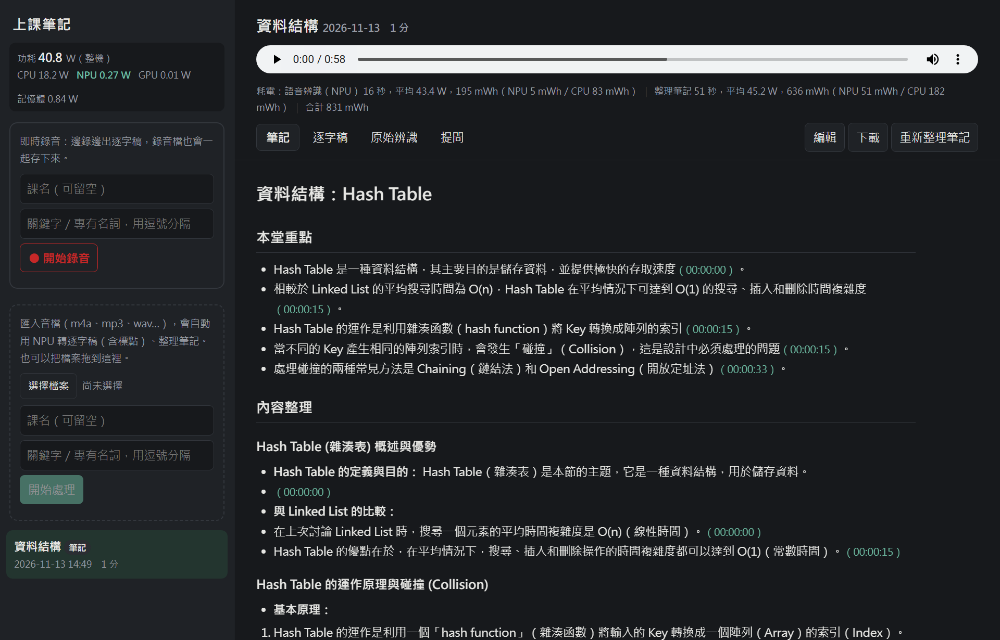
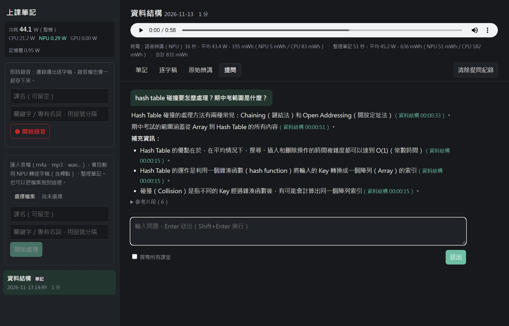

# Lecture Notes

**Record a lecture, get a transcript, detailed notes and a Q&A assistant that cites timestamps, all running offline on your own Windows PC.**

The speech recognizer runs on the **Snapdragon NPU** when GenieX is installed, and on llama.cpp (CPU or GPU) everywhere else. It is built for Taiwanese Mandarin lectures with heavy Chinese–English code-switching.

[繁體中文說明](README.md)



## Features

- **Import audio or video** (m4a, mp3, wav, mp4…), or **record live**: the transcript appears while you record.
- **Speech recognition with [TEA-ASR-1.1](https://huggingface.co/JacobLinCool/TEA-ASR-1.1)**, a Qwen3-ASR fine-tune for Taiwanese Mandarin. It outputs Traditional Chinese with punctuation, keeps English terms intact, and takes course keywords as hotwords.
- **Detailed notes** written by a local LLM (Gemma 4 by default):
  - key points
  - per-topic sections
  - glossary table
  - homework, exam and deadline list
  - "please verify" list

  Every bullet links back to its timestamp in the recording.
- **Ask questions** about one lecture or all of them. BM25 retrieval finds the passages, and the answer cites the course and time, so one click plays that moment.
- **Speaker diarization** (optional, off by default): transcript lines are tagged 【老師】 (teacher) or 【學生1】 (student 1) and so on. Student questions and the teacher's answers become a "課堂問答" (class Q&A) section in the notes. Click a name to rename that speaker. Runs on the CPU with sherpa-onnx.
- **Power meter**: on Snapdragon PCs the sidebar shows live system, CPU, NPU and GPU power from the Windows Energy Meter, and each step logs the Wh it used.
- **Private**: audio, transcripts and notes never leave your computer.



## Benchmarks

Measured on a 58-second mixed Chinese–English test lecture on a Snapdragon X2 Elite laptop:

| Speech recognition | Character error rate | Time |
|---|---|---|
| TEA-ASR-1.1 on NPU (GenieX) | 2.4% | ~11 s |
| TEA-ASR-1.1 via llama.cpp, CPU | 2.4% | ~17 s (incl. server start) |
| Breeze-ASR-25 via whisper.cpp, CPU | 4.9% | ~18 s |

## Install

Runs on Windows 10 or 11, Linux, and Android via Termux. The steps below are for Windows; see [Linux](#linux) and [Android (Termux)](#android-termux) further down. 16 GB RAM is recommended; with 8 GB, pick the small model. It needs about 8 GB of disk space.

1. Get the files: download the [latest release](../../releases/latest), or use **Code → Download ZIP**, or `git clone`.
2. Double-click **安裝.bat** (Install). It downloads everything into the folder:
   - portable Python
   - ffmpeg
   - llama.cpp
   - the TEA-ASR model
   - speaker diarization if you opt in (sherpa-onnx, about 60 MB)
   - an LLM of your choice: Gemma 4 E4B or E2B, an existing Ollama or LM Studio, GenieX, or none
3. Double-click **上課筆記.bat** (Lecture Notes). Your browser opens http://127.0.0.1:18484/.

The installer changes no system settings. To uninstall, delete the folder.

### Linux

Needs Python 3.9+, ffmpeg and curl (`sudo apt install python3 ffmpeg curl` on Ubuntu).

```bash
git clone https://github.com/alexchen9419/lecture-notes.git
cd lecture-notes
bash install.sh
bash lecture.sh
```

Then open http://127.0.0.1:18484/. The installer downloads the official llama.cpp build (CPU or Vulkan), TEA-ASR and the LLM you pick into the folder. There is no NPU, Breeze-ASR or power meter on Linux. Live recording uses the default PulseAudio/PipeWire input; set `"mic"` in `config.json` to ffmpeg input arguments to change it. Tested in an Ubuntu 24.04 ARM64 container (install, import, diarization, notes); x64, Vulkan and live recording are untested.

### Android (Termux)

Install Termux from [F-Droid](https://f-droid.org/packages/com.termux/), then:

```bash
pkg install python ffmpeg curl tar git
git clone https://github.com/alexchen9419/lecture-notes.git
cd lecture-notes
bash install.sh
bash lecture.sh
```

Open http://127.0.0.1:18484/ in the phone's browser. It needs an ARM64 phone with at least 8 GB RAM (12 GB recommended) and about 5.5 GB for models. Everything runs on the CPU with the official Android build of llama.cpp, so it is much slower than a PC. There is no live recording (record with any recorder app and import the file), no diarization and no power meter. So far this has only been tested in the official Termux Docker image, not on a real phone.

### Using the NPU

Install Qualcomm's GenieX CLI first. The installer detects it and offers to run TEA-ASR on the NPU. The audio encoder runs on the CPU and the decoder runs on the Hexagon NPU.

## How it works

```
audio ─ ffmpeg 16 kHz ─ pause-based segmentation (≤ 28 s) ─ TEA-ASR (GenieX NPU / llama-server)
      ─ transcript with timestamps ─ LLM: per-topic detailed notes ─ overview, glossary, exams
      ─ BM25 over transcript + notes ─ LLM answer with (course hh:mm:ss) citations
```

Notes for anyone running Qwen3-ASR or TEA-ASR GGUFs through llama.cpp or GenieX:

- Always send a `system` message, even an empty one. Without it the model emits `language Chinese` and stops.
- Even with a system message, some segments still return only `language Chinese`, on both CPU and NPU. Retrying with an assistant prefill of `language Chinese<asr_text>` fixes it, on llama-server and on GenieX.
- The mradermacher GGUF emits stray private-use characters (U+E000–U+F8FF) after some words. Strip them.
- On GenieX, start the server with `--vit-compute CPU`. Putting the audio encoder on HTP crashes the server.

## Credits

- [TEA-ASR-1.1](https://huggingface.co/JacobLinCool/TEA-ASR-1.1) by JacobLinCool (MIT), based on Qwen3-ASR (Apache 2.0). The GGUF was converted by mradermacher.
- [llama.cpp](https://github.com/ggml-org/llama.cpp) and [whisper.cpp](https://github.com/ggml-org/whisper.cpp) (MIT).
- [Breeze-ASR-25](https://huggingface.co/MediaTek-Research/Breeze-ASR-25) by MediaTek Research (Apache 2.0).
- Gemma 4 by Google (Gemma Terms of Use).
- FFmpeg (GPL build by BtbN) and OpenCC.
- [sherpa-onnx](https://github.com/k2-fsa/sherpa-onnx) (Apache 2.0), pyannote segmentation 3.0 (MIT) and 3D-Speaker ERes2Net (Apache 2.0) for speaker diarization.

## License

MIT
